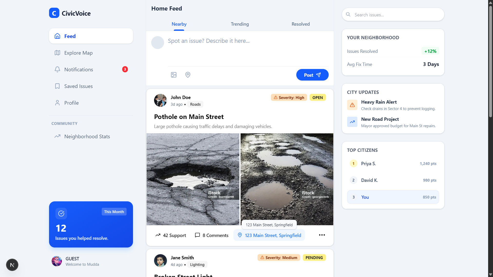
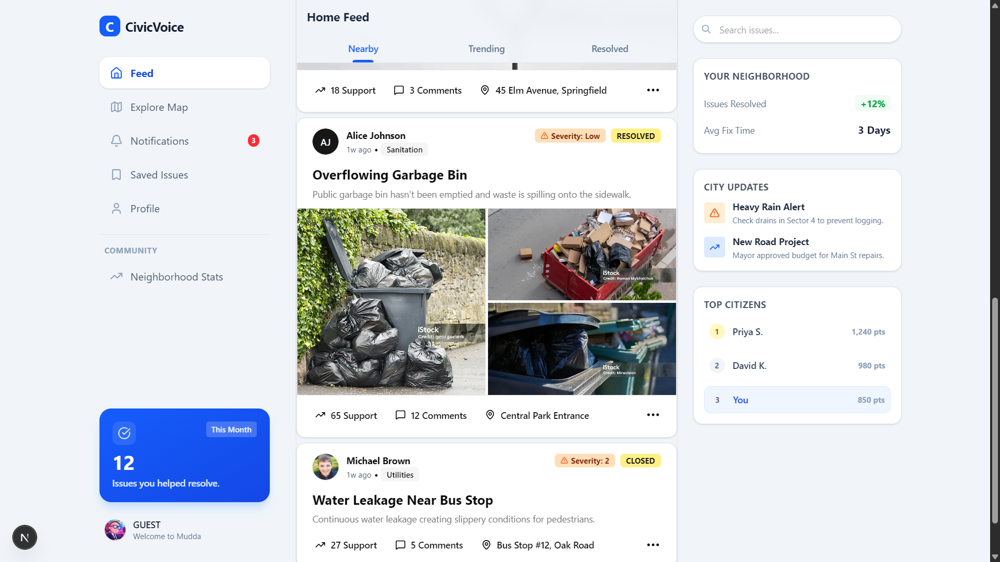
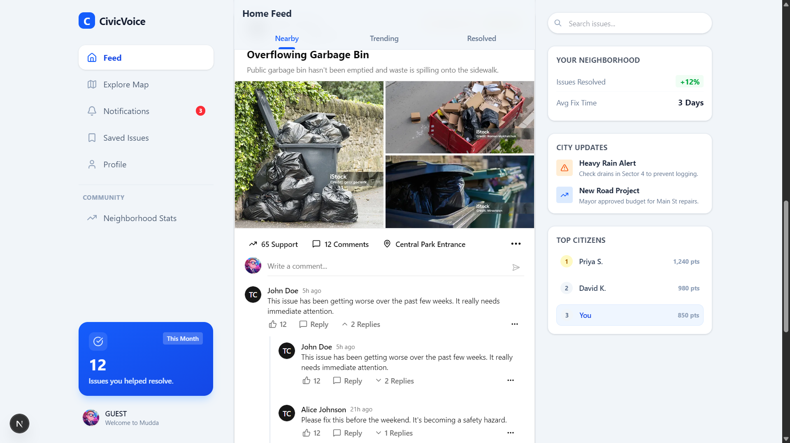

## Mudda-Frontend

A social media like feed for project Mudda to show civic issues more like social posts.

Shows feed fetched by pages automatically.

Loads comments with 1 Level of reply nesting.

Inspired by Twitter UI design

Hoping to work on it more >-<

## Tech Stack

Created using NextJS, Bun, TypeScript (TS), Tailwind, Shadcn

I love type safety so using TS.

### Images

#### Feed

#### Feed Continues

#### Comment Section

#### Reply Section

